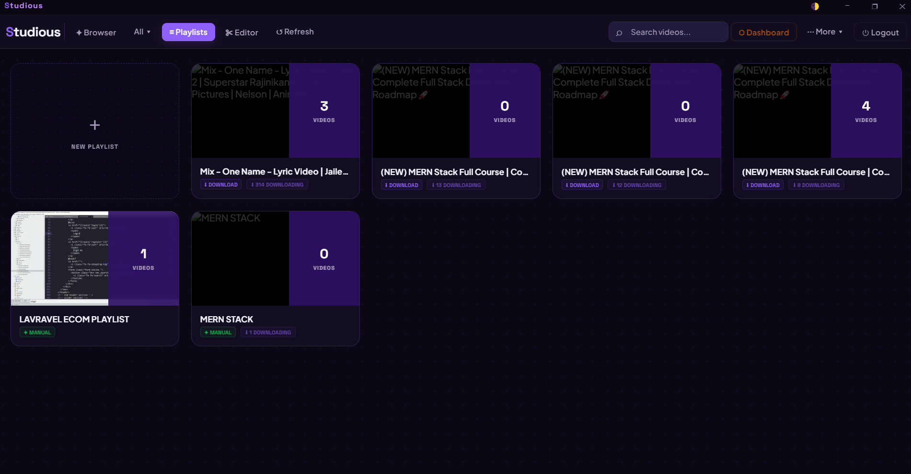
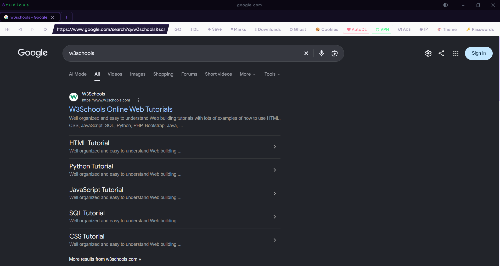
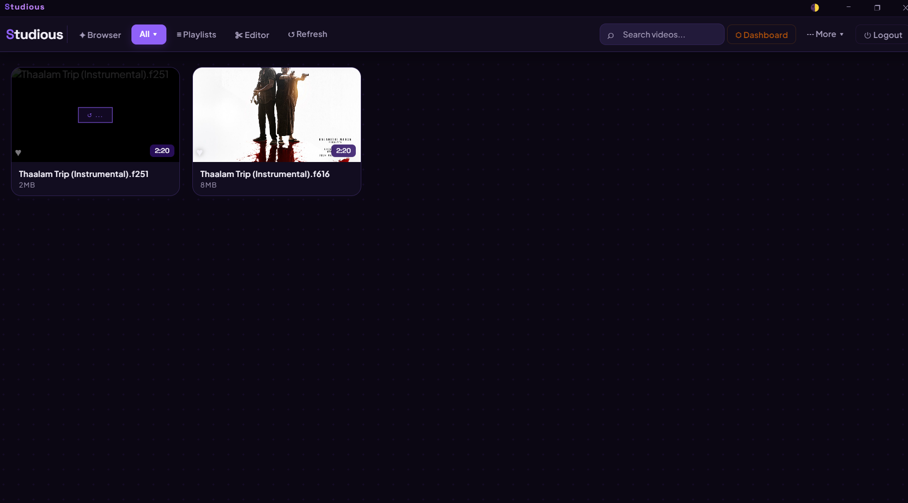
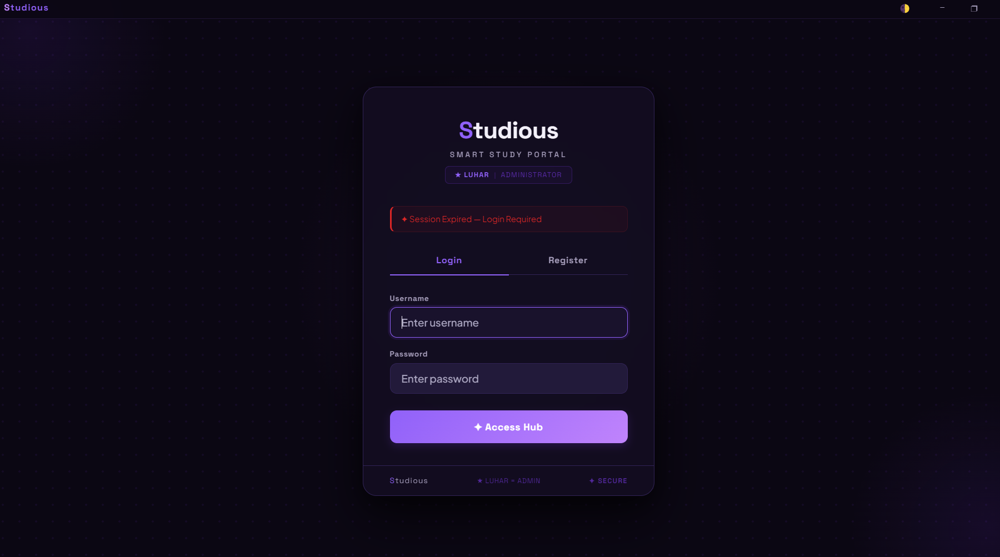

# 🎓 Studious — Smart Offline Study Hub & Lecture Vault

[](https://www.electronjs.org/)
[](https://nodejs.org/)
[](https://threejs.org/)
[](https://github.com/yt-dlp/yt-dlp)
[](https://ffmpeg.org/)
[](LICENSE)

**Studious** is an all-in-one, distraction-free educational desktop application designed for students, researchers, and self-learners. It allows you to discover, stream, archive, organize, and edit video lectures, research materials, and educational playlists offline — complete with an immersive 360° virtual classroom player, timestamped study notes, and focus music.

---

## ✨ Features

### 🎓 1. Lecture Vault & Offline Archive
- **Distraction-Free Video Player**: Custom high-performance video player with variable playback speeds (0.25x to 3x), frame-by-frame preview scrubbing, and audio boost up to 300%.
- **Secure Encrypted Storage**: Video vault with lightweight XOR encryption and optimized metadata caching.
- **Auto-Generated Previews**: Automatic generation of hover preview clips and animated thumbnails for rapid lecture scanning.

### 🌐 2. Integrated Research Browser
- **Universal Stream Sniffer**: Real-time passive detection of HLS (`.m3u8`), segmented streams, and direct media URLs across educational platforms (YouTube Edu, MIT OCW, Coursera, Khan Academy, edX, TED, Vimeo).
- **Distraction & Ad Blocker**: Built-in content blocking to eliminate noisy web ads, banners, and sidebar distractions.
- **Smart Educational Save**: One-click download trigger on lecture bookmarking and like actions.
- **Cookie & Session Management**: Import and export Netscape cookie sessions for authenticated institutional academic portals.

### 🥽 3. 360° / VR Panoramic Classroom Viewer
- **Immersive Learning**: Powered by Three.js WebGL rendering with interactive spherical projection (`SphereGeometry`).
- **Smooth Mouse & Gyro Drag**: Pan, zoom, and explore 360-degree educational recordings, lab simulations, and virtual lecture halls.
- **Adaptive Fullscreen**: Dynamic canvas auto-resizing and FOV controls during lecture presentation.

### ✂️ 4. Integrated Lecture Clip Editor
- **Precise Trimming**: Set millisecond-accurate start and end points to extract key lecture concepts and theorems.
- **Video Concatenation & Merging**: Merge multiple lesson segments into a comprehensive study masterclass without quality loss.
- **Audio Extraction**: Convert video lectures to MP3/M4A audio podcasts for on-the-go listening during commutes.

### 📝 5. Structured Curricula & Timestamped Notes
- **Curriculum Playlists**: Organize video files into multi-part courses with drag-and-drop ordering and batch operations.
- **Synchronized Lecture Notes**: Take Markdown notes tied directly to individual lecture videos with instant auto-save.
- **Watch History & Analytics**: Visual completion tracking, resume-from-last-watched position, and study time analytics.

### 🎧 6. Ambient Study Music Player
- **Focus Soundtracks**: Dedicated background audio player for lo-fi, binaural beats, and ambient study music.
- **Audio Equalizer & Boost**: Integrated audio controls with independent volume balancing alongside lecture audio.

### 🔒 7. Privacy & Network Routing
- **Tor Network Integration**: Optional routing through Tor proxy for accessing regional or restricted academic research archives.
- **Atomic Data Safety**: Fail-safe atomic writes (`writeJsonAtomic`) with automatic recovery from timestamped backups.

---

## 📸 Screenshots

| Study Dashboard & Lecture Vault | Research Browser & Stream Sniffer |
| :---: | :---: |
|  |  |

| Lecture Clip Editor & Notes | Media Player & 360° Classroom View |
| :---: | :---: |
|  |  |

---

## 🛠️ Architecture & Tech Stack

- **Framework**: [Electron](https://www.electronjs.org/) (Multi-window architecture, IPC bridge with context isolation)
- **3D / VR View**: [Three.js](https://threejs.org/) (WebGL spherical video texturing)
- **Media Engine**: [FFmpeg](https://ffmpeg.org/) (Video transcoding, thumbnail extraction, trimming, merging)
- **Stream Ingestion**: [yt-dlp](https://github.com/yt-dlp/yt-dlp) (Universal video & manifest download engine)
- **UI & Styling**: Pure modern CSS with custom theme variables (Light Scholar & Academic Night modes)

---

## 🚀 Getting Started

### Prerequisites

- [Node.js](https://nodejs.org/) (v18.0.0 or higher recommended)
- [npm](https://www.npmjs.com/) or [pnpm](https://pnpm.io/)
- Windows, macOS, or Linux

### Installation

1. **Clone the repository:**
   ```bash
   git clone https://github.com/your-username/studious.git
   cd studious
   ```

2. **Install dependencies:**
   ```bash
   npm install
   ```

3. **Set up Binary Tools (Windows):**
   Studious utilizes `ffmpeg.exe` and `yt-dlp.exe` for media processing:
   - Place `ffmpeg.exe`, `ffprobe.exe`, and `yt-dlp.exe` inside the `bin/` directory (or ensure they are available in your system `PATH`).
   - *(Optional)* Place `tor.exe` in `bin/tor/` if using privacy routing features.

4. **Start the application:**
   ```bash
   npm start
   ```

---

## 📁 Project Structure

```
Studious/
├── bin/                 # Media binaries (ffmpeg, yt-dlp, tor)
├── cookies/             # Academic session cookie configurations
├── browser.html         # Research browser UI & stream sniffer
├── index.html           # Main dashboard, lecture vault, 360° viewer, editor
├── login.html           # Authentication portal & session gatekeeper
├── main.js              # Electron main process, IPC handlers, backup engine
├── preload.js           # Secure contextBridge IPC exposure
├── package.json         # Project manifests and build configuration
└── playlists.json       # Course curriculum & playlist state
```

---

## ⌨️ Keyboard Shortcuts

| Shortcut | Action |
| :--- | :--- |
| `Space` | Play / Pause lecture |
| `F` | Toggle Fullscreen |
| `M` | Mute / Unmute Audio |
| `←` / `→` | Seek backward / forward 5 seconds |
| `↑` / `↓` | Increase / Decrease volume |
| `[` / `]` | Decrease / Increase playback speed |
| `V` | Toggle 360° Panoramic Classroom View |
| `Ctrl + B` | Open Built-in Research Browser |
| `Ctrl + N` | Open Study Notes panel |

---

## 📄 License

This project is licensed under the MIT License — see the [LICENSE](LICENSE) file for details.

